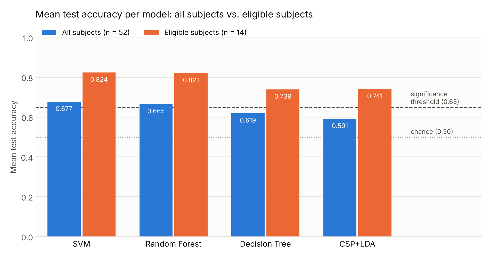

# EEG Motor Imagery for Post-Stroke Rehabilitation

Classification of motor imagery (left hand vs. right hand) from EEG signals, using multi-domain feature engineering and per-subject training on the **Cho2017** dataset.

Final project of the **Diploma in Data Science and Artificial Intelligence Applied to Health Research**, Mentorship Project 3.

**Authors:** Mariel Anachuri, Clara Inés Chungara, Camila Giolitto
**Mentor:** Bruno Zorzet

📄 [Full report (PDF, in Spanish)](Informe.pdf)

---

## Problem

Motor imagery brain-computer interfaces (MI-BCIs) decode movement intention from EEG, with applications in post-stroke motor rehabilitation. Deploying them faces two challenges:

- **High inter-subject variability:** each person has their own spectral and spatial signatures, which makes a single global model hard to use.
- **BCI illiteracy:** a substantial share of users do not produce brain patterns discriminative enough to operate a BCI reliably.

## Data

- Cho2017 dataset: 52 subjects, ~200 trials per subject, balanced classes.
- Channels C3, Cz and C4, resampled to 128 Hz.
- Consolidated dataset: 10,520 trials × 51 features.

The dataset is not included in this repository.

## Methodology

**1. Feature engineering (51 descriptors per trial)**

| Family | Features |
|---|---|
| Frequency domain | Total power (RMS), power in 6 bands via Welch (4–8, 8–12, 12–16, 16–20, 20–24, 28–30 Hz) |
| Time domain and complexity | Kurtosis, skewness, Katz fractal dimension, AR coefficients (order 2), permutation entropy (order 3) |
| Spatial and connectivity | Cross-correlation, magnitude-squared coherence (MSC) and Phase Locking Value between C3–Cz, C4–Cz and C3–C4 |

**2. Within-subject training**

For each subject: stratified 80/20 split, `GridSearchCV` with stratified 5-fold cross-validation on the 80% training set, and scaling wrapped inside a `Pipeline` to prevent data leakage.

Models compared: Decision Tree, Random Forest, SVM and CSP+LDA (baseline, fitted on the raw EEG signal).

**3. BCI illiteracy filter**

Accuracy threshold derived from the binomial distribution under the null hypothesis of a random classifier (p = 0.5, α = 0.05). Given the test set size, the threshold came out at **0.650**. Subjects who exceed it with CSP+LDA are considered "eligible".

## Results

Mean test accuracy:

| Model | All (52 subjects) | Eligible (14 subjects) |
|---|---|---|
| SVM | 0.677 | 0.824 |
| Random Forest | 0.665 | 0.821 |
| Decision Tree | 0.619 | 0.739 |
| CSP+LDA | 0.591 | 0.741 |



- All models performed above chance on average. SVM and Random Forest performed best.
- The low performance of CSP+LDA is attributed to the small number of channels, which limits the estimation of spatial covariance matrices.
- Only 14 of 52 subjects (26.9%) passed the 0.650 threshold with CSP+LDA.
- In the eligible subgroup, SVM and Random Forest exceeded 0.80 mean accuracy.

## Limitations

- Limited sample size per subject (~200 trials) for grid searches.
- Fixed frequency bands for all subjects, not tuned to each person's mu and beta rhythms.
- Eligible subjects are selected using CSP+LDA test accuracy and then evaluated on those same test sets, which may overestimate performance in the eligible subgroup.
- Formal feature selection (SelectKBest, RFE, Lasso) and t-SNE/UMAP visualization were left as future work.

## Future work

Explore deep learning architectures such as EEGNet, which learn spatial and temporal filters directly from the raw signal.

## How to reproduce

The script uses the `PreprocessedDataset` class from the [mentorship repository](https://github.com/bzorzet98/BCI-MENTORIA-UNC), which handles EEG loading and preprocessing.

```bash
git clone https://github.com/bzorzet98/BCI-MENTORIA-UNC.git
pip install -r requirements.txt
BCI_REPO_PATH=/path/to/BCI-MENTORIA-UNC python bci_motor_imagery.py
```

The script:

1. Extracts the 51 features per subject and exports the dataset to CSV.
2. Generates the exploratory data analysis plots.
3. Trains and evaluates the 4 models per subject.
4. Applies the BCI illiteracy filter and compares all subjects against the eligible ones.

Plots are saved to `results/figures/`, and per-subject models and metrics to `models/` and `models_aptos/` (eligible subjects).

## Repository structure

```
├── bci_motor_imagery.py   # full pipeline: features, EDA, training and evaluation
├── requirements.txt
├── Informe.pdf            # full report (Spanish)
├── figures/
│   └── model_comparison.png   # results chart shown in this README
└── .gitignore
```

> The report and the code (comments, variable names and plot labels) are in Spanish, as this was original coursework.
